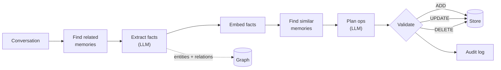
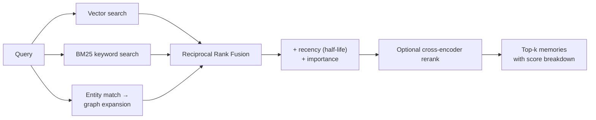

<div align="center">

# mnemo

**Long-term memory for LLM agents.** Extracts facts from conversations, resolves contradictions,
and retrieves the right memories with hybrid vector + keyword + knowledge-graph search.

[](https://github.com/dhruv-deepak/mnemo/actions/workflows/ci.yml)


[How it works](#how-it-works) · [Results](#results) · [Quickstart](#quickstart) ·
[REST API](#rest-api) · [MCP](#use-it-from-claude-desktop-cursor-or-any-mcp-client) ·
[Design notes](docs/architecture.md)

</div>

---

LLMs forget everything between conversations. The usual workarounds break down quickly:

- **Stuffing the whole history into the prompt** gets slow and expensive, and eventually
  doesn't fit.
- **Naive RAG over raw chat logs** retrieves stale or contradictory messages ("I live in
  Delhi" next to "I moved to Pune") and misses facts spread across turns.

mnemo is a memory layer that sits between your agent and its LLM. It turns conversations into
a clean, deduplicated, self-updating store of facts, and serves them back in milliseconds.

```python
from mnemo import Memory

memory = Memory()  # SQLite + local embeddings by default; Groq/OpenAI/Gemini/Ollama for the LLM

memory.add("I'm Dhruv, a CS student in Mumbai. I'm vegetarian.", user_id="dhruv")

result = memory.add("Big news, I moved to Bangalore last week for an internship!", user_id="dhruv")
for e in result.events:
    print(e.event.value, e.new_content, f"({e.reason})" if e.reason else "")
# UPDATE Dhruv lives in Bangalore (New fact updates location, replacing outdated Mumbai info)
# ADD    Dhruv started an internship in Bangalore in the week before 13 October 2026
# ADD    Dhruv lives in Bangalore as of the week before 13 October 2026 (merge dropped details)

memory.search("Where does Dhruv live?", user_id="dhruv")[0].memory.content
# 'Dhruv lives in Bangalore'
```

The second message did not create a contradictory memory. mnemo worked out that "I" is
Dhruv, **updated** "Dhruv lives in Mumbai" (the old version stays in the memory's history),
stored the internship as its own event, and anchored "last week" to the conversation date.
The model's merged text had dropped the date, so a deterministic check also kept the dated
fact (`merge dropped details`).

## Features

- **LLM fact extraction.** Atomic, self-contained facts typed as *semantic*, *episodic* or
  *procedural*, each with an importance score, entities and relations. Relative dates are
  anchored to the conversation date ("yesterday" becomes "on 7 May 2023").
- **Conflict resolution.** New facts are compared with similar stored memories, and the LLM
  plans `ADD` / `UPDATE` / `DELETE` / `NONE` operations. Safeguards: hallucinated ids are
  rejected, and facts the plan forgets are added rather than dropped.
- **Hybrid retrieval.** Vector similarity, BM25 keyword search and knowledge-graph expansion
  are fused with Reciprocal Rank Fusion, then weighted by recency and importance, with an
  optional cross-encoder rerank. Every result includes a per-signal score breakdown.
- **Knowledge graph.** Entities and relations are extracted alongside facts, and multi-hop
  expansion finds memories that share no words with the query.
- **Audit history.** Every change is logged with before/after text and a reason.
  `delete_all(user_id)` erases everything, history included.
- **Production API.** FastAPI with API-key auth, token-bucket rate limiting, Prometheus
  metrics, structured JSON logs, request ids and Docker.
- **MCP server.** Plug long-term memory into Claude Desktop, Cursor or Claude Code.
- **Pluggable.** Any OpenAI-compatible LLM. Local CPU embeddings (no API cost). Storage on
  SQLite (zero setup) or Postgres + pgvector (HNSW).
- **Evaluated.** A reproducible LoCoMo benchmark with baselines and ablations, plus a
  latency benchmark.

## How it works

### Write path: `memory.add(conversation)`



1. **Context-aware extraction.** The extractor first sees the stored memories most related to
   the conversation. That lets it resolve who "I" is, and it doesn't re-extract facts that are
   already known.
2. **Consolidation.** For each new fact, mnemo retrieves the most similar existing memories.
   The LLM sees them under short aliases (`"0"`, `"1"`, ...) instead of UUIDs, because models
   copy short ids reliably but corrupt 32-character hex strings. Every id the model returns is
   mapped back and validated.
3. **Safety nets.** A fact referenced only by a rejected operation or a `DELETE` is still
   added. Writes are serialised per user, so two concurrent requests can't both add the same
   fact.

### Read path: `memory.search(query)`



Cosine similarity, BM25 and graph distance are on incomparable scales, so mnemo fuses them by
**rank** rather than raw score:

$$\text{RRF}(d) = \sum_{s \in \{\text{vector},\,\text{keyword},\,\text{graph}\}} \frac{1}{k + \text{rank}_s(d)}$$

The normalised RRF score is then blended with recency (`0.5^(age / half_life)`) and the
memory's importance. Each signal can be switched off, which is how the ablations below were
produced.

## Results

### LoCoMo long-term memory benchmark

[LoCoMo](https://snap-research.github.io/locomo/) (ACL 2024) tests memory over very long
multi-session conversations: on average 588 turns over 19–32 sessions (about 21k tokens)
per conversation, with questions that need facts spread across sessions. Every system uses
the same answer model, prompt and LLM judge.

<!-- LOCOMO_RESULTS -->
_Benchmark run in progress; results will be published here._

### Search latency

End-to-end hybrid search (query embedding + vector + BM25 + graph + fusion) on the SQLite
backend, single process, CPU only:

| Memories per user | Query embedding | Vector scan | BM25 | **End-to-end p50** | p95 |
|---|---|---|---|---|---|
| 1,000 | 3.8 ms | 0.2 ms | 1.1 ms | **7.8 ms** | 9.3 ms |
| 10,000 | 3.9 ms | 0.6 ms | 14.1 ms | **36.0 ms** | 75.5 ms |
| 50,000 | 4.0 ms | 2.4 ms | 95.0 ms | **227 ms** | 264 ms |

Profiling showed the first version spent most of its time reading embedding blobs from
SQLite on every query. A per-user embedding cache cut vector-scan time at 10k memories from
**40.6 ms to 0.6 ms** (end-to-end p50 from 76 ms to 36 ms). Keyword search is now the largest
cost at scale, and the Postgres backend (GIN index, HNSW) is the path beyond that.

Reproduce both:

```bash
python -m benchmarks.latency
python -m benchmarks.locomo run --samples 0 --systems mnemo mnemo-no-graph mnemo-vector rag
```

Methodology and limitations are in [`benchmarks/README.md`](benchmarks/README.md).

## Quickstart

```bash
git clone https://github.com/dhruv-deepak/mnemo.git && cd mnemo
python -m venv .venv && source .venv/bin/activate   # Windows: .venv\Scripts\activate
pip install -e ".[all]"
cp .env.example .env                               # add GROQ_API_KEY (free at console.groq.com)
```

**Chat with a memory-enabled assistant in your terminal:**

```bash
mnemo chat --user me -v       # -v shows every ADD / UPDATE / DELETE as it happens
```

**Run the web demo** (chat, memory inspector, search playground, knowledge graph):

```bash
streamlit run demo/app.py
```

**Use it as a library:**

```python
from mnemo import Memory

memory = Memory()
result = memory.add([{"role": "user", "content": "Please always reply in Hindi."}], user_id="rohan")
print(result.events[0].event, result.events[0].new_content)
# ADD  User prefers assistant to reply in Hindi

for hit in memory.search("what language?", user_id="rohan"):
    print(f"{hit.score:.2f}", hit.memory.content, hit.breakdown)
# 0.99 User prefers assistant to reply in Hindi vector_rank=1 keyword_rank=None graph_rank=None
#      vector_similarity=0.617 rrf=1.0 recency=1.0 importance=0.9 rerank=None

memory.history(result.events[0].memory_id)  # full audit trail
memory.delete_all("rohan")  # forget a user completely
```

## REST API

```bash
mnemo serve                    # or: docker compose up   (API + Postgres/pgvector)
open http://localhost:8000/docs
```

| Method | Endpoint | Description |
|---|---|---|
| `POST` | `/v1/memories` | Add a conversation (`messages`, `user_id`, optional `timestamp`, `infer`) |
| `POST` | `/v1/memories/search` | Hybrid search with per-signal score breakdown |
| `GET` | `/v1/memories?user_id=` | List memories (filter by `agent_id`, `type`) |
| `GET` / `PATCH` / `DELETE` | `/v1/memories/{id}` | Read, edit or delete one memory |
| `GET` | `/v1/memories/{id}/history` | Audit trail of a memory |
| `GET` | `/v1/users/{user_id}/graph` | Entity–relation graph |
| `DELETE` | `/v1/users/{user_id}` | Delete everything about a user |
| `GET` | `/health`, `/metrics` | Health check, Prometheus metrics |

```bash
curl -X POST localhost:8000/v1/memories -H "content-type: application/json" \
  -d '{"messages": "I am allergic to peanuts", "user_id": "rohan"}'
curl -X POST localhost:8000/v1/memories/search -H "content-type: application/json" \
  -d '{"query": "food allergies", "user_id": "rohan"}'
```

Set `MNEMO_API_KEYS=key1,key2` to require an `X-API-Key` or `Authorization: Bearer` header.
Requests are rate limited per key (or per IP) with a token bucket and return `429` with
`Retry-After` when exceeded.

## Use it from Claude Desktop, Cursor or any MCP client

```json
{
  "mcpServers": {
    "mnemo": {
      "command": "mnemo",
      "args": ["mcp"],
      "env": { "GROQ_API_KEY": "...", "MNEMO_SQLITE_PATH": "/path/to/memory.db" }
    }
  }
}
```

Tools exposed: `remember`, `recall`, `list_memories`, `forget`.

## Configuration

All settings are environment variables (or `.env`). See [`.env.example`](.env.example).

| Variable | Default | |
|---|---|---|
| `MNEMO_LLM_PROVIDER` | `groq` | `groq`, `openai`, `gemini`, `ollama` or `custom` (any OpenAI-compatible URL) |
| `MNEMO_LLM_MODEL` | `openai/gpt-oss-120b` | Provider-specific default if unset |
| `MNEMO_EMBEDDER` | `fastembed` | Local `BAAI/bge-small-en-v1.5` on CPU, or `openai` |
| `MNEMO_STORE` | `sqlite` | `sqlite` or `postgres` (`MNEMO_POSTGRES_URL`) |
| `MNEMO_RECENCY_HALF_LIFE_DAYS` | `30` | How fast old memories fade in ranking |
| `MNEMO_RERANK` | `false` | Cross-encoder rerank of the top candidates |
| `MNEMO_API_KEYS` | empty | Comma-separated keys; empty means an open API |

## Project structure

```
mnemo/
├── memory.py          # Memory: the public API (add / search / update / delete / history)
├── extraction.py      # conversation -> typed facts, entities, relations
├── consolidation.py   # LLM-planned ADD/UPDATE/DELETE/NONE with validation
├── retrieval.py       # hybrid search, RRF, recency/importance, rerank
├── store/             # SQLite (FTS5 + NumPy) and Postgres (pgvector HNSW + tsvector)
├── server/            # FastAPI app, rate limiter, JSON logging, Prometheus metrics
├── mcp_server.py      # MCP tools
├── agent.py           # minimal memory-enabled chat agent
└── cli.py
benchmarks/            # LoCoMo evaluation + latency benchmark
demo/                  # Streamlit demo
tests/                 # 65+ tests, deterministic (scripted LLM, hash embeddings)
```

## Development

```bash
pip install -e ".[dev]"
pytest                       # runs fully offline: no API keys or model downloads
ruff check . && ruff format --check . && mypy
```

CI runs lint, type checking (mypy), tests on Python 3.11 and 3.12 against both SQLite and a real Postgres +
pgvector service, and builds and smoke-tests the Docker image.

## Roadmap

- [ ] Async API and streaming writes (extraction off the request path by default)
- [ ] Memory decay and periodic consolidation ("sleep") of related episodic memories
- [ ] Multi-tenant org scopes and per-agent sharing rules
- [ ] Redis-backed rate limiter for multi-replica deployments

## Acknowledgements

Inspired by the [Mem0 paper](https://arxiv.org/abs/2504.19413) and
[Dave Ebbelaar's AI cookbook](https://github.com/daveebbelaar/ai-cookbook). Evaluated on
[LoCoMo](https://github.com/snap-research/locomo).

## License

MIT
